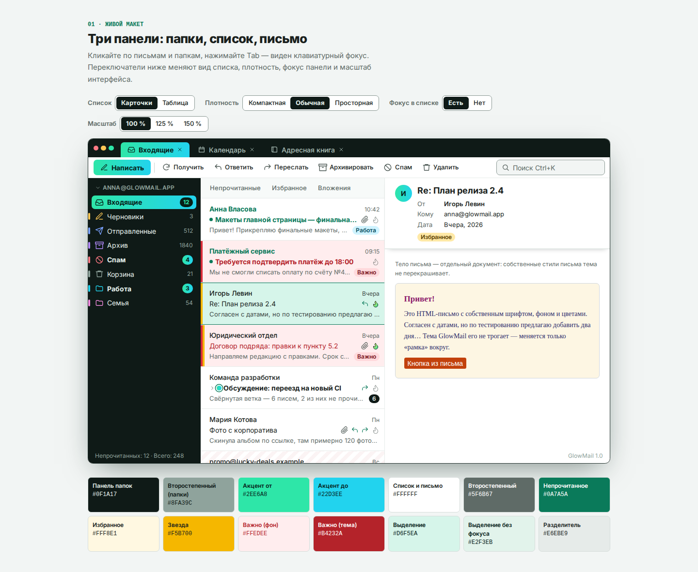
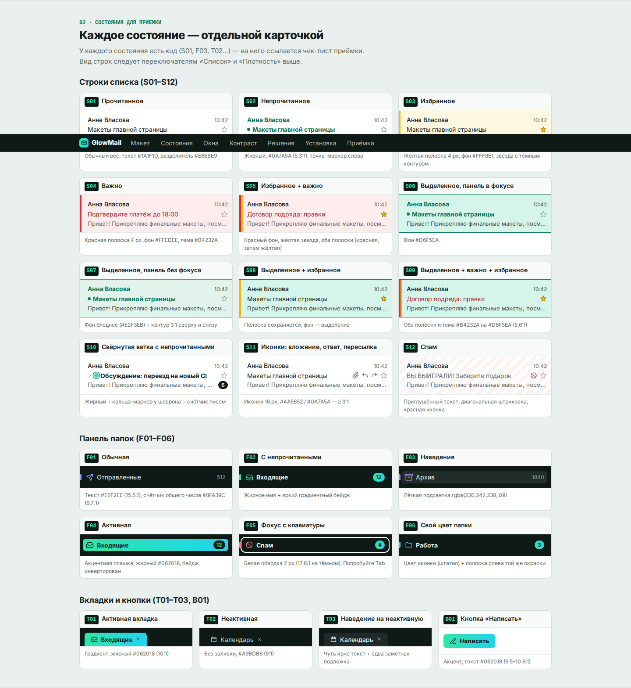
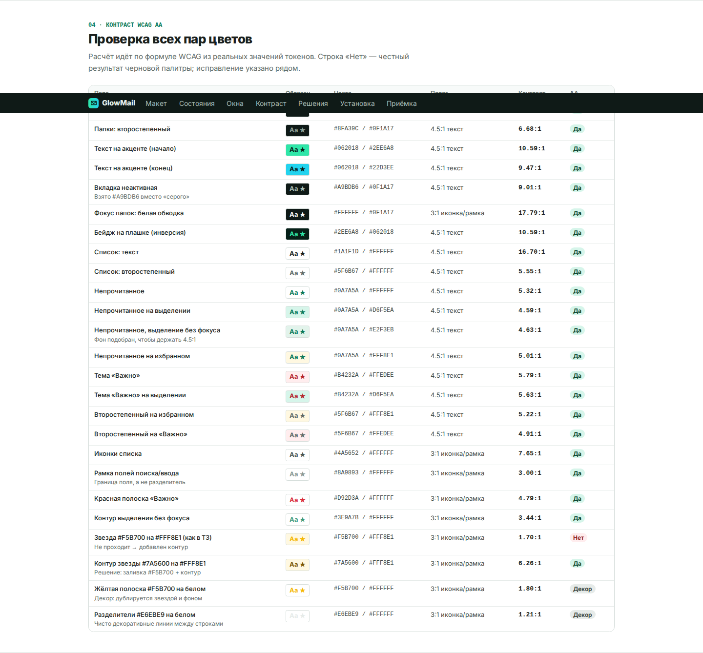

# GlowMail — тема для Thunderbird / Betterbird

Тёмная панель папок с мятно-бирюзовым акцентом, светлый список писем и письмо.
Thunderbird 128+ / Betterbird. Версия 1.3.1 проверена в Betterbird 153.6.0.



## Как выглядит и где смотреть

- **Обзор темы текстом** — [`docs/overview.md`](docs/overview.md): палитра, разделы стенда, решения по ТЗ, установка, приёмка.
- **Скриншоты по разделам** — [`docs/screenshots/`](docs/screenshots/): макет, состояния для приёмки, окна, контраст, решения, установка, приёмка; целиком — `00-full.png` и `glowmail-stand-full.pdf`.
- **Сам стенд одним файлом** — [`docs/index.html`](docs/index.html): готовая сборка страницы (шрифты и скрипты внутри, интернет не нужен). Скачайте файл и откройте в браузере — макет интерактивный, кнопки скачивания `.xpi` / `userChrome.css` работают.

Исходная страница жила на Arena (`*.arena.site`) и может исчезнуть — репозиторий от неё не зависит: стенд пересобирается из `src/` (см. ниже), а `docs/index.html` — его готовая копия. После правок стенда обновляйте копию: `npm run build`, затем скопировать `dist/index.html` в `docs/index.html`.

| Состояния для приёмки | Контраст WCAG AA |
|---|---|
|  |  |

## Из чего состоит

| Часть | Что красит | Файл |
|---|---|---|
| WebExtension-тема | рамка окна, вкладки, панели инструментов, меню, поля | `theme/manifest.json` → `glowmail-theme.xpi` |
| userChrome.css | список писем, папки, акцентные плашки, бейджи, окно письма, написание, адресная книга | `theme/chrome/userChrome.css` + `theme/chrome/fonts/` |

Полная инструкция — в [`theme/INSTALL.md`](theme/INSTALL.md).

В `.xpi` входят манифест, стили, иконки и шрифт. Установи файл через **Дополнения и темы → ⚙ → Установить дополнение из файла…**, включи GlowMail в разделе **Темы** и перезапусти программу.

## Стенд-спецификация

В репозитории лежит и сайт-стенд (Vite + React 19 + Tailwind 4, `src/`): живой макет трёх панелей, состояния для приёмки, проверка контраста, решения по ТЗ и кнопки скачивания. Файлы `.xpi` / `userChrome.css` / архив с шрифтом собираются прямо в браузере из исходников темы (`src/lib/zip.ts`).

```bash
npm install
npm run dev     # стенд
npm run build   # сборка в dist/ (один index.html)
```

## Структура

```
theme/                  # источник правды: тема и userChrome
  manifest.json
  INSTALL.md
  chrome/userChrome.css
  chrome/fonts/         # Inter (variable, латиница + кириллица), OFL
src/                    # стенд-спецификация
public/download/        # копии userChrome.css и INSTALL.md для скачивания со стенда
```

`public/download/` — копия файлов из `theme/`, держите их в синхроне (сверяйте md5).

## Примечание от 10.11.2026

В исходном архиве не хватало `theme/chrome/fonts/Inter-*.woff2`, из-за чего `npm run build` падал (`Could not resolve ... Inter-latin.woff2`). Шрифты восстановлены из уже заявленной зависимости `@fontsource-variable/inter` (Inter, SIL OFL) — `inter-latin-wght-normal.woff2` и `inter-cyrillic-wght-normal.woff2`. После этого сборка проходит, `manifest.json` валиден, `userChrome.css` — 648 строк, скобки сходятся, секретов в репозитории не найдено (проверка перед публикацией — см. `AGENTS.md`).

Лицензия репозитория пока не выбрана.
